[UML_README.md](https://github.com/user-attachments/files/35371942/UML_README.md)
# TaskFlow — оглавление UML-диаграмм проекта (ДЗ-1 — ДЗ-5)

Список всех диаграмм экзаменационного проекта TaskFlow: каждая диаграмма — название, файл и что показывает.

## Диаграммы ДЗ-1

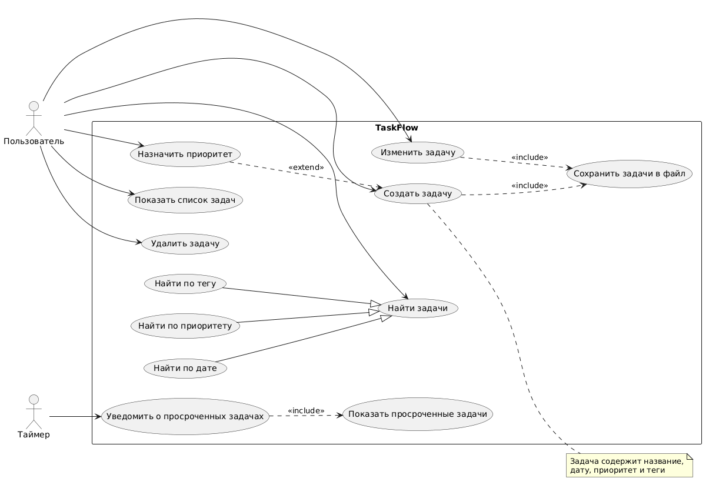

**Диаграмма вариантов использования** — `uml/01_usecase.png`. Что пользователь и таймер напоминаний могут делать в TaskFlow: добавить, найти, отметить, сохранить задачу, получить напоминание.

## Диаграммы ДЗ-2

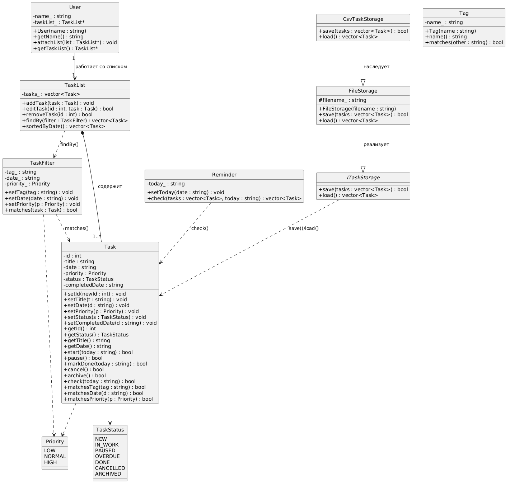

**Диаграмма классов (предметная область)** — `uml/02_class_domain.png`. Все классы TaskFlow и отношения между ними: состав, агрегация, обобщение, зависимость, ассоциация, реализация. Обновление в ДЗ-4: добавлены Menu и TaskService. Обновление в ДЗ-5: добавлены AppSettings, TaskCreator и его наследники, IStorageFactory, ISettingsStorage и их реализации.

## Диаграммы ДЗ-3

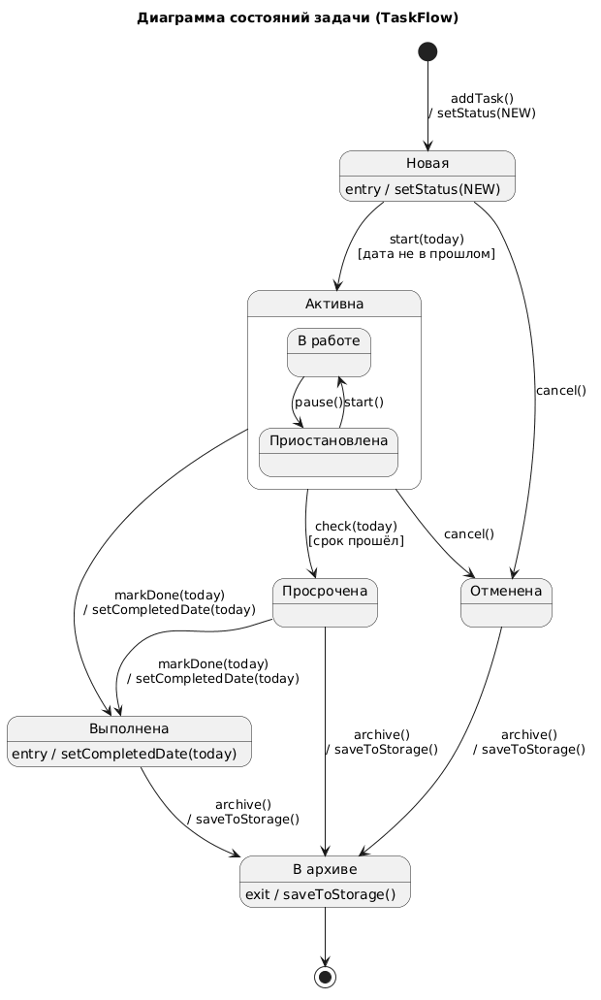

**Диаграмма состояний задачи** — `uml/03_state_task.png`. Жизненный цикл задачи: создана → активна → выполнена (с возвратом, если задачу переоткрыли) и составное состояние «Активна».

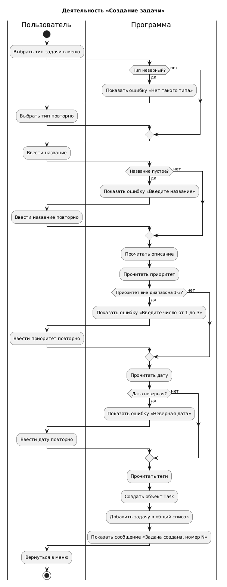

**Диаграмма деятельности «Добавить задачу»** — `uml/03_activity_create.png`. Процесс «Добавить задачу»: действия, решения и потоки от ввода данных до сохранения.

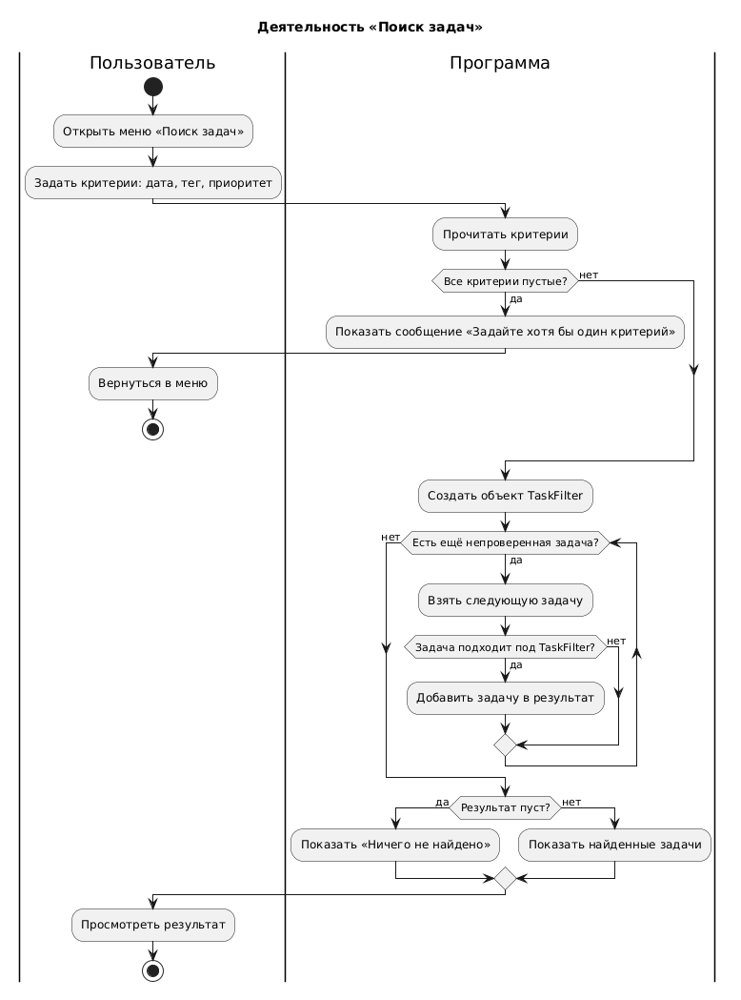

**Диаграмма деятельности «Найти задачу»** — `uml/03_activity_search.png`. Процесс «Найти задачу»: поиск по критериям до отображения результата.

## Диаграммы ДЗ-4

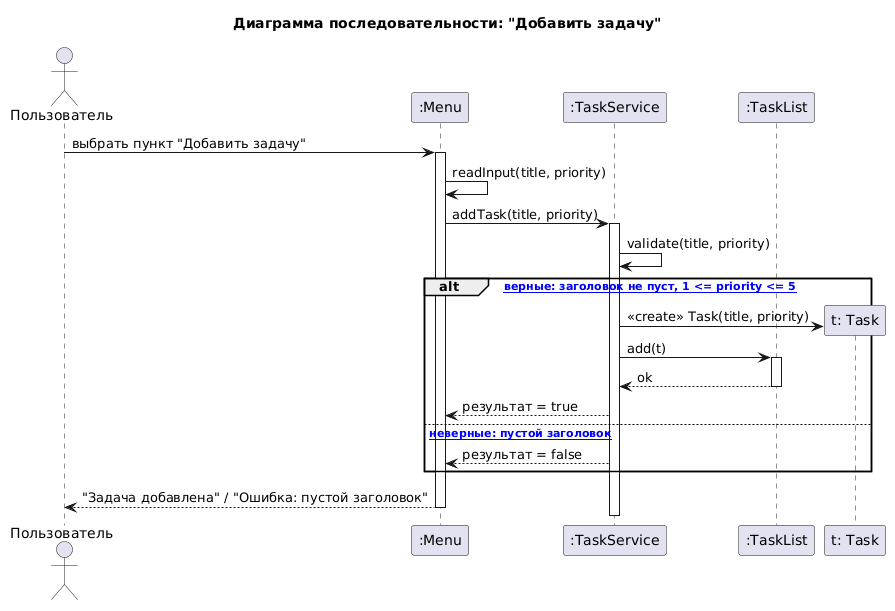

**Диаграмма последовательности «Добавить задачу»** — `uml/04_seq_add.png`. Полный сценарий от меню до сохранения с веткой alt: данные верные / проверки ошибок.

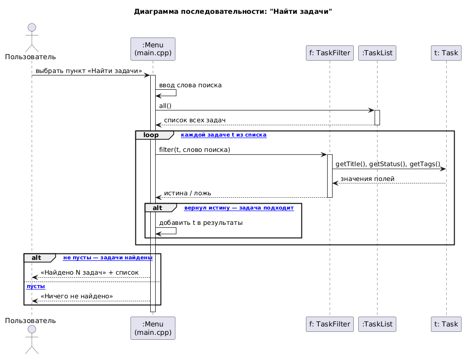

**Диаграмма последовательности «Найти задачу»** — `uml/04_seq_search.png`. Поиск по критериям: цикл по задачам и alt «найдено / ничего не найдено».

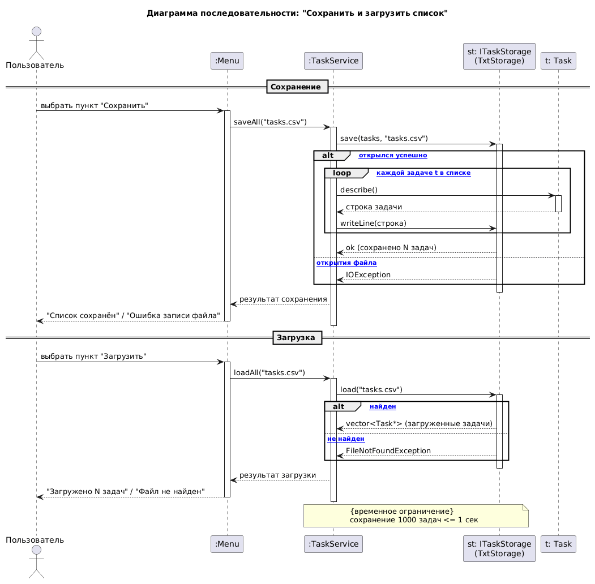

**Диаграмма последовательности «Сохранить и загрузить список»** — `uml/04_seq_save.png`. Работа с файлом: alt «файл открылся / ошибка» и временное ограничение сохранения.

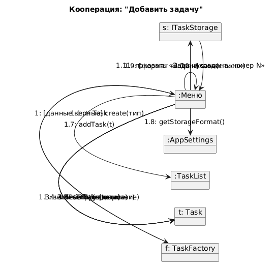

**Кооперативная диаграмма «Добавить задачу»** — `uml/04_communication_add.png`. Те же объекты и сообщения, нумерация 1, 1.1–1.4 и условия в квадратных скобках.

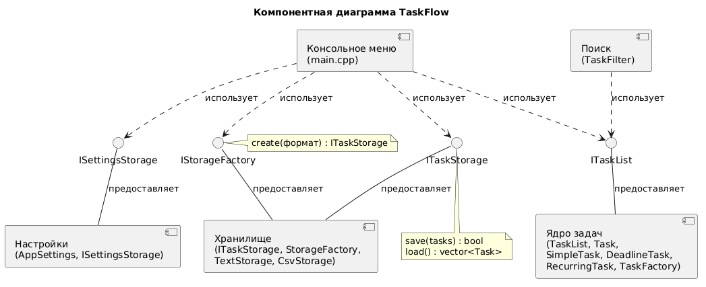

**Компонентная диаграмма** — `uml/04_component.png`. Крупные части программы (меню, ядро, хранилище) и интерфейсы: ITaskStorage, ITaskPrinter.

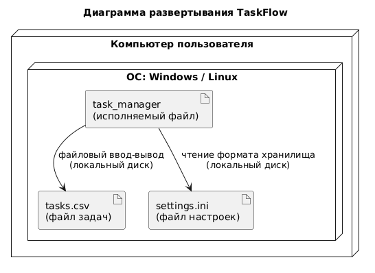

**Диаграмма развертывания** — `uml/04_deployment.png`. TaskFlow работает на одном компьютере; артефакты: исполняемый файл, файл задач (Tasks.txt или Tasks.csv — по настройкам), файл настроек; по желанию — облачная синхронизация по HTTPS.

## Диаграммы ДЗ-5

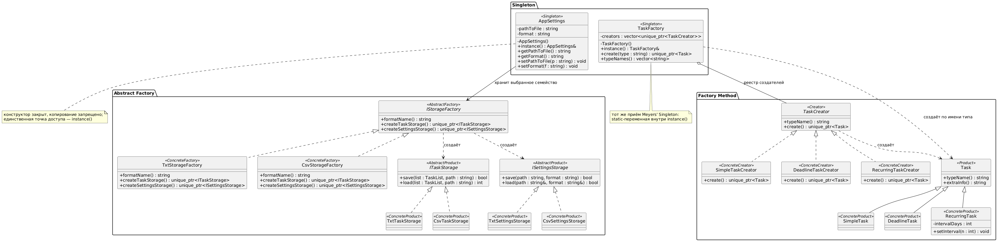

**Диаграмма порождающих паттернов** — `uml/05_creational.png`. Три паттерна в коде TaskFlow: Singleton (AppSettings, TaskFactory), Factory Method (создатели типов задач), Abstract Factory (семейства TXT и CSV) — с ролями в стереотипах.
